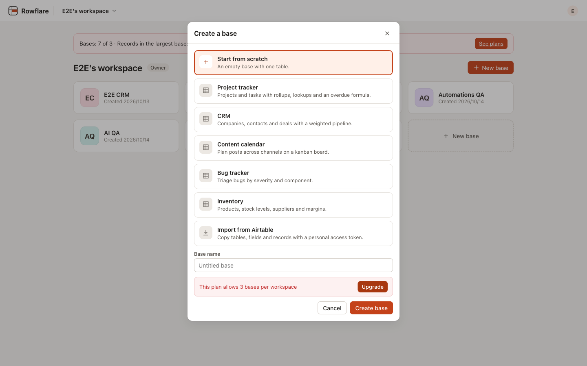
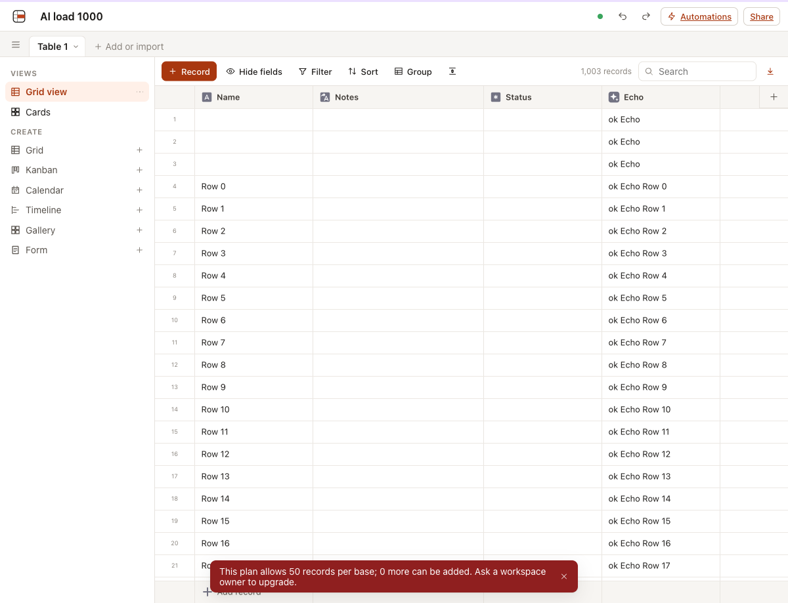
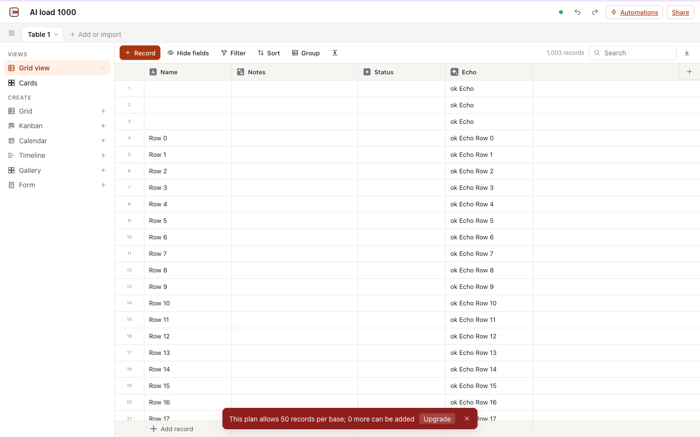
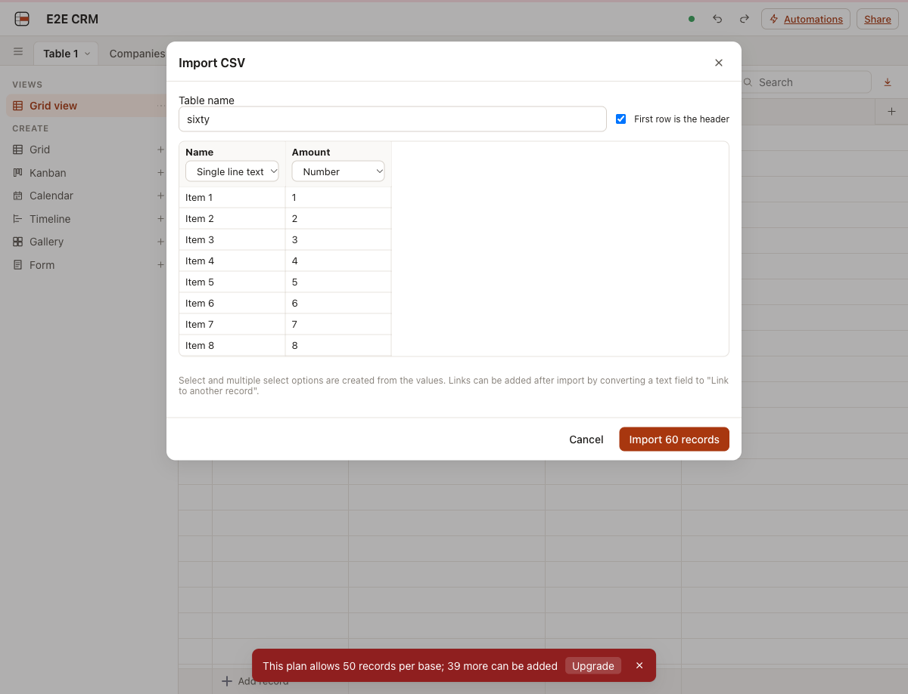
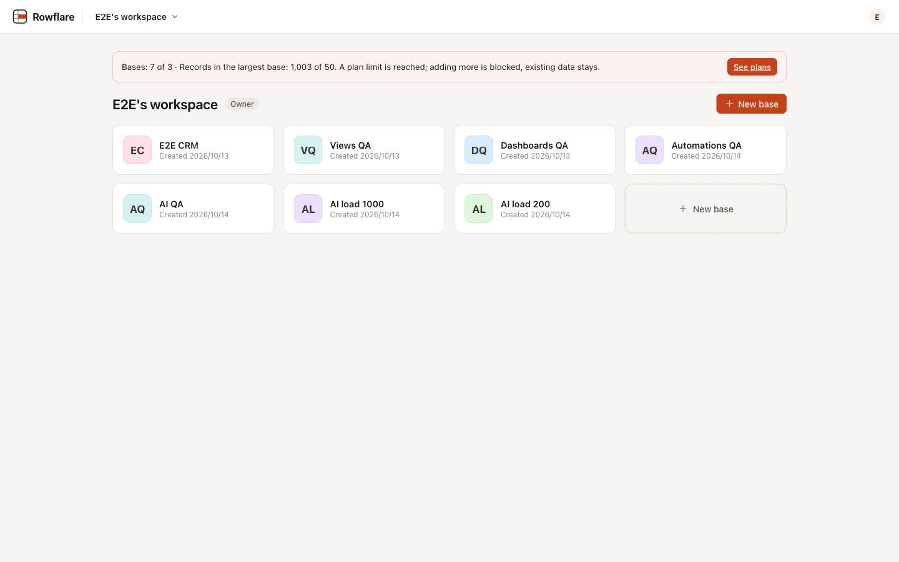
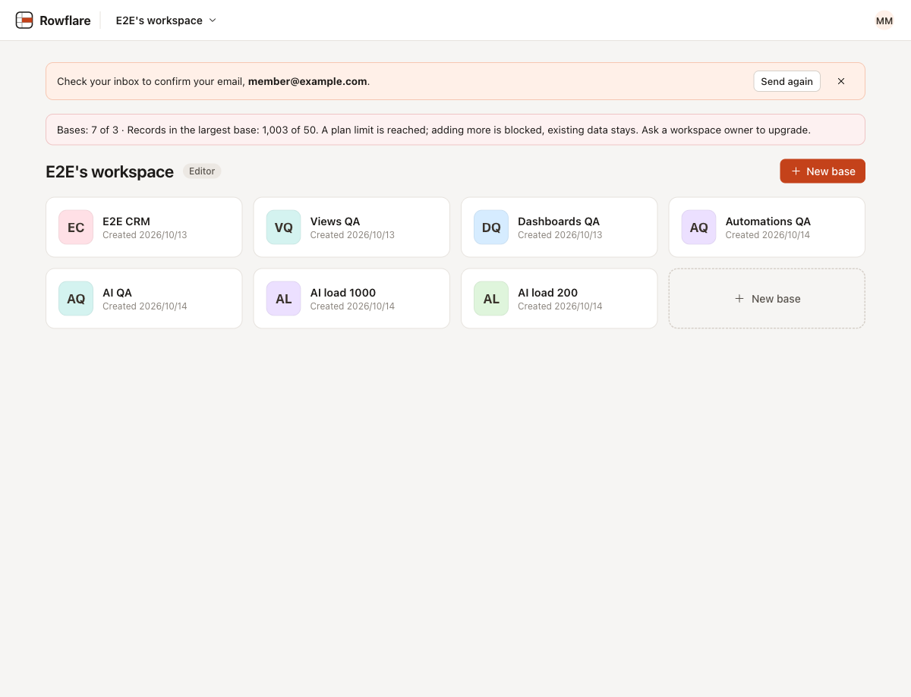
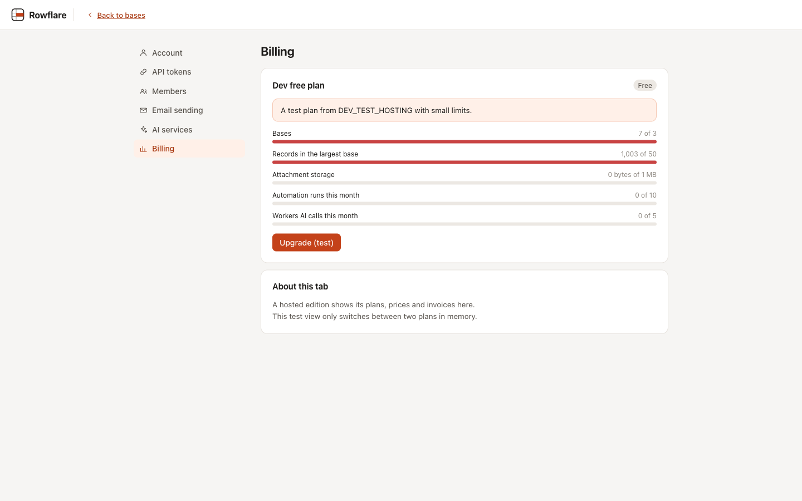
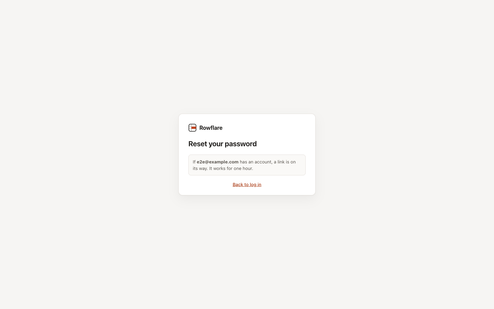
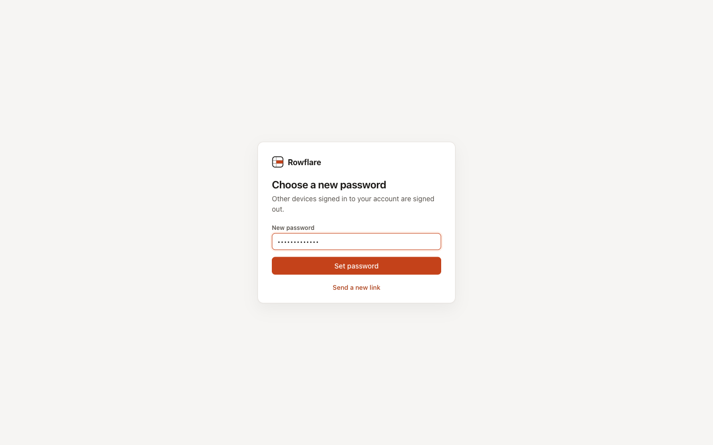
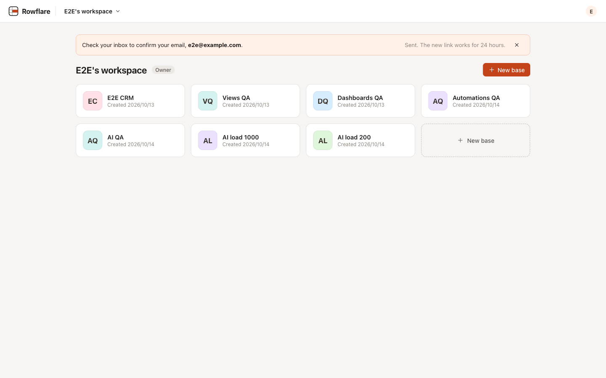

# Plan limits, account emails and hosting extensions: verification record

Date: 2026-10-14. Feature: the open-source side of the hosted edition ([spec](../superpowers/specs/2026-10-14-hosting-extensions-design.md)).

## What was tested

- The hosting extension point: the self-hosted default (no limits beyond `AUTOMATION_MONTHLY_RUNS` and `AI_WORKERS_MONTHLY_CALLS`), a registered hosting's plans, routes, billing view and hooks, and the 60-second plan cache.
- Usage limits from the plan: bases per workspace, records per base (one record, a paste, an import, automation steps, forms, the REST API, linked records made by typecast, field conversions), attachment storage per workspace with the hourly recount (sizes from R2, never from cells; unused files deleted after a week), automation runs per month per base or per workspace, and Workers AI calls per month.
- A hosting whose plan lookup fails: writes keep the last plan.
- Limits never delete data: over a lowered limit records stay editable, and deleting records frees room at once.
- The usage and billing routes, the 402 answer with its `limit` object, and the app's messages: Upgrade for owners, "Ask a workspace owner to upgrade" for other members, a notice at 80% of a limit, and the generic Billing tab.
- Email verification and password reset: single-use tokens that expire, at most 5 emails per address an hour, the same answer for unknown addresses, a reset that ends other sessions, and the pages around them.
- Stripe, trials and the read-only state after a trial are gone; the migration drops their columns.

## How

- Worker integration tests (Vitest in workerd with real Durable Objects, D1 and R2) with a test hosting that sets small limits: base creation over the limit, pastes and imports over the record limit, a downgrade that keeps records editable, uploads over the storage limit and a recount that frees deleted files while keeping uploads made during it, the workspace run limit including two bases queueing runs before either writes its count, per-base run limits, Workers AI calls from the plan, the usage numbers for a workspace with two bases, records, an upload and AI calls, and the billing route.
- Account email tests with a captured mailer: sign-up mails a confirmation link, links work once and expire, Send again, Forgot password for unknown and real addresses, reset with a short password, reset from a signed-in and a signed-out browser, the hourly limit, and an instance without mail.
- Unit tests of the app's limit messages (owner and member) and of the usage numbers' formatting.
- UI checks with Playwright against `wrangler dev`, with `DEV_TEST_HOSTING=true` (a test hosting with 3 bases, 50 records per base, 1 MB of files, 10 runs and 5 Workers AI calls a month, and a fake Billing tab) and account emails sent to a local SMTP server on 127.0.0.1:2525 (a test tool, not part of the repo).
- Docker runtime check: `docker/server.mjs` with `MAIL_PROVIDER=smtp`; sign-up and Forgot password delivered both emails to the local SMTP server.

## Results

Tests: 45 of 45 passed in 4 files (`npm run verify`, 2026-10-14). The whole suite: 651 of 651.

Scenarios:

| Scenario | Checked | Result |
| --- | --- | --- |
| Base limit as owner | A workspace with 7 bases on a plan of 3: Create base answers 402 and the dialog shows "This plan allows 3 bases per workspace" with Upgrade, which opens Settings, Billing | pass |
| Record limit, owner and member | A base with 1,003 records on a plan of 50: adding a record is refused and the count stays 1,003; the owner's message has Upgrade, an editor's says "Ask a workspace owner to upgrade." | pass |
| Usage notice | Home lists the limits at 80% or more (bases 7 of 3, records 1,003 of 50) with See plans for owners and the ask-an-owner line for others | pass |
| CSV import over the limit | A 60-record CSV into a base with room for 39 is refused with "This plan allows 50 records per base; 39 more can be added" before the table is created | pass |
| Billing tab | Plan, usage bars for five limits, notice, notes and buttons from the hosting; Upgrade (test) POSTs, follows the returned URL and shows the paid plan's limits; back to free works | pass |
| Password reset | Forgot password sends the email through SMTP; the link sets a new password and signs the browser in; the same link again is refused | pass |
| Email confirmation | The banner shows for an unconfirmed account; Send again mails a new link; the link confirms the address once | pass |

## Known limits

- Removed attachments free storage at the next hourly recount, not at once; uploads never put in a cell count for a day; files no cell uses are deleted from R2 after a week.
- Attachments uploaded before this release are counted by the size in their cell (never below zero).
- With runs counted per workspace, a base does not see runs other bases queued in the last second, so a workspace can go slightly over when several bases fire at once.
- Converting a text field to links in a full base leaves the names that would need new linked records unlinked.
- A plan change reaches a base within 60 seconds unless the hosting calls `BaseDO.planChanged()`.
- Unconfirmed accounts work normally; requiring confirmation (for example before a checkout) is up to the hosted edition.
- The Docker image has no Cloudflare Email Service; account emails there need `MAIL_PROVIDER` with Resend or SMTP.
