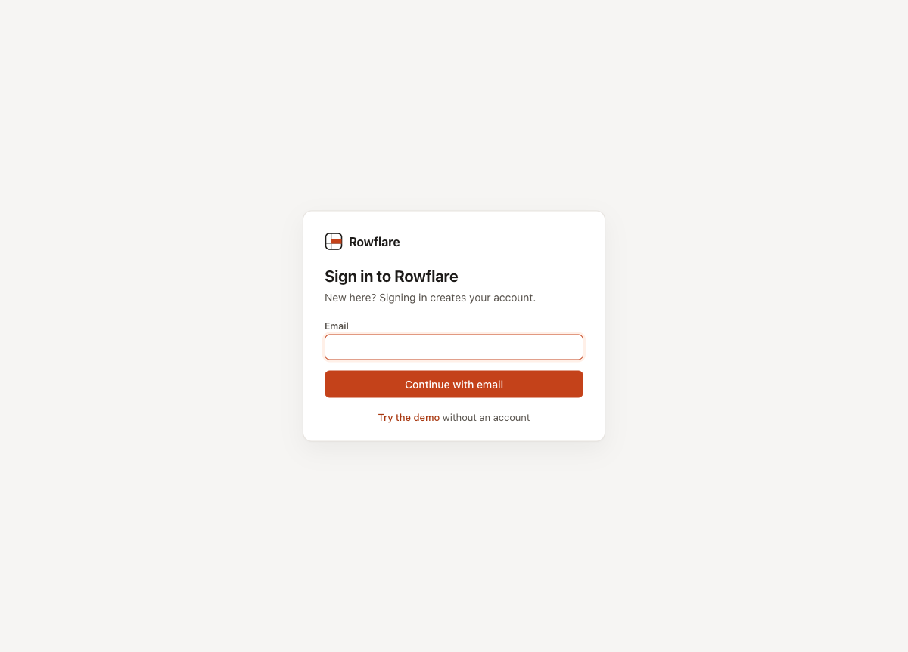
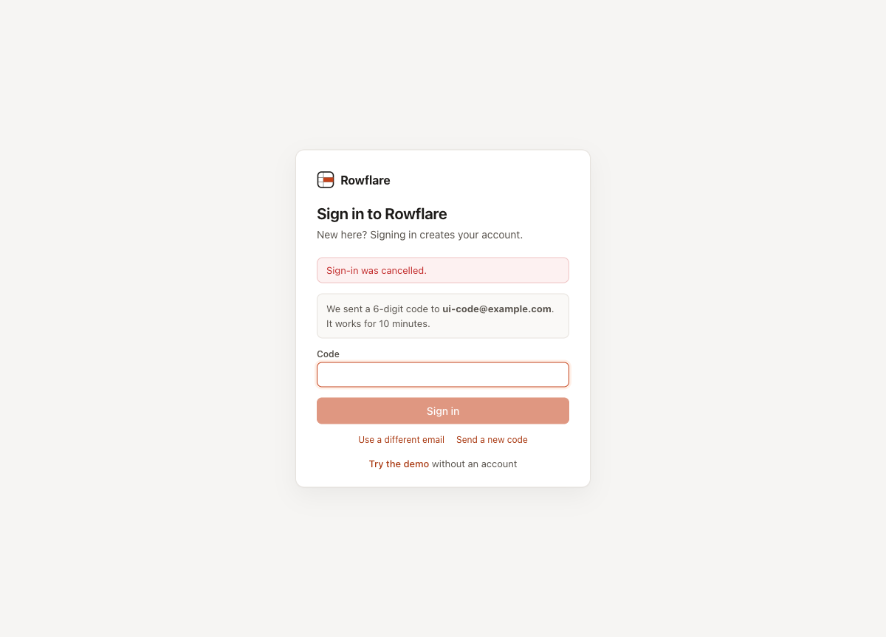

# Email code sign-in and sign-in options: verification record

Date: 2026-10-21. Feature: passwordless sign-in for instances that turn it on (`AUTH_EMAIL=code`), sign-in buttons from a hosting (`Hosting.signInOptions`), and the account helpers both share.

## What was tested

- Shared account helpers: an account created for a proven email is verified, has no password and gets "<name>'s workspace"; the same email in another case or with spaces finds the same account; an existing unconfirmed account becomes confirmed; invites are accepted for new and existing accounts; closed sign-up refuses new emails without an invite.
- Email code mode (`AUTH_EMAIL=code`): 6-digit codes that work once, for 10 minutes, with at most 5 wrong tries even when guesses arrive in parallel; a new code voids the older one; at most 5 codes per address, 10 per network address and 1,000 per instance an hour, also under a burst; a bad invite is refused before an account is made or the code is used; the same answer for every address; invites; password routes off; the mode needs account email; password mode unchanged.
- Sign-in options from a hosting, listed by `/api/config` and shown above the email form; sign-in errors shown only as fixed texts from a short code; the path to open after sign-in kept inside the app; sign-in posts refused without the `x-rf` header.

## How

- Worker integration tests (Vitest in workerd with real D1 and Durable Objects) with a captured mailer: `test/worker/accounts.test.ts`, `test/worker/email-code.test.ts`, the sign-in options test in `test/worker/hosting.test.ts`, and unit tests of the error texts and the next-path check in `test/unit/sign-in.test.ts`.
- UI checks with Playwright against `wrangler dev` with `AUTH_EMAIL=code` and account emails sent to a local SMTP server on 127.0.0.1:2525 (a test tool, not part of the repo), then again without `AUTH_EMAIL`. The buttons for sign-in options are checked in the hosted edition, which is the only place that provides them.

## Results

Tests: 34 of 34 passed in 4 files (`npm run verify`, 2026-10-21). The whole suite: 686 of 686.

| Scenario | Checked | Result |
| --- | --- | --- |
| Sign up with an email code | The page asks only for an email, the 6-digit code arrives, entering it creates the account and its workspace and opens Home | pass |
| Join from an invite with a code | A signed-out person opens an invite, asks for a code, uses Send a new code and enters the newest code: they join as an editor and get no workspace of their own | pass |
| No passwords anywhere in code mode | `/forgot` goes to the sign-in page, Settings, Account has no Password section, and the password routes answer 404 | pass |
| Readable sign-in errors | `/login?error=Sign-in was cancelled.` shows the text above the form | pass |
| Password mode unchanged | Without `AUTH_EMAIL` the log-in page still has Email, Password, Forgot password? and Sign up | pass |

## Known limits

- The code is in the email body only, not the subject.
- An instance switched to code mode keeps existing password hashes in D1 but no longer uses them.
